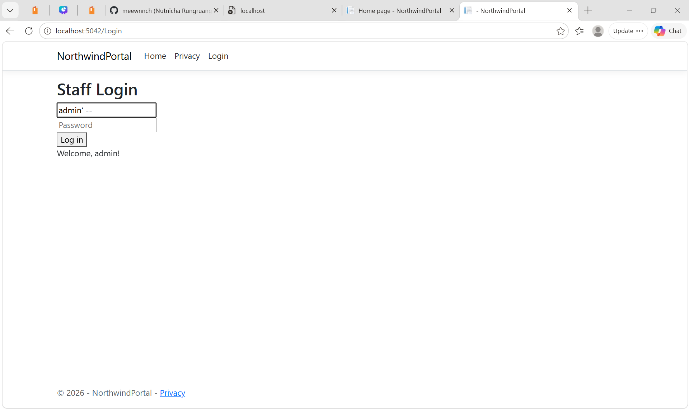
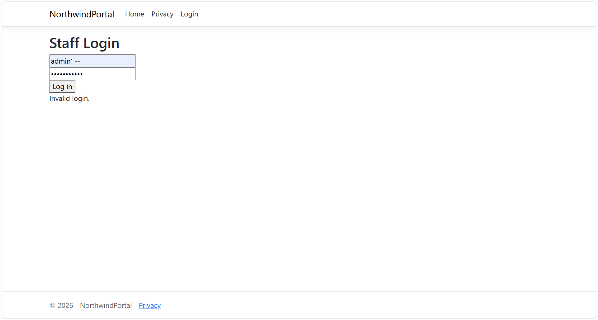
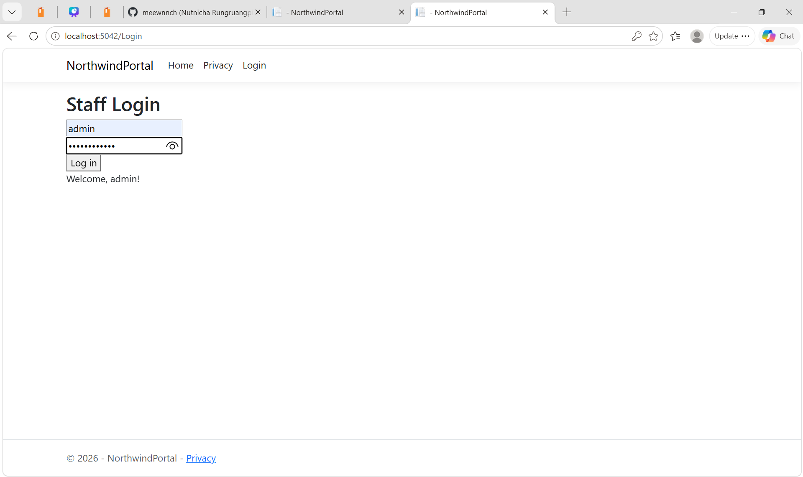
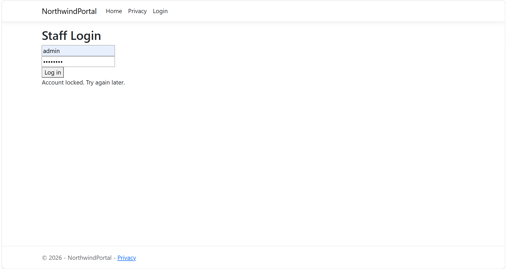
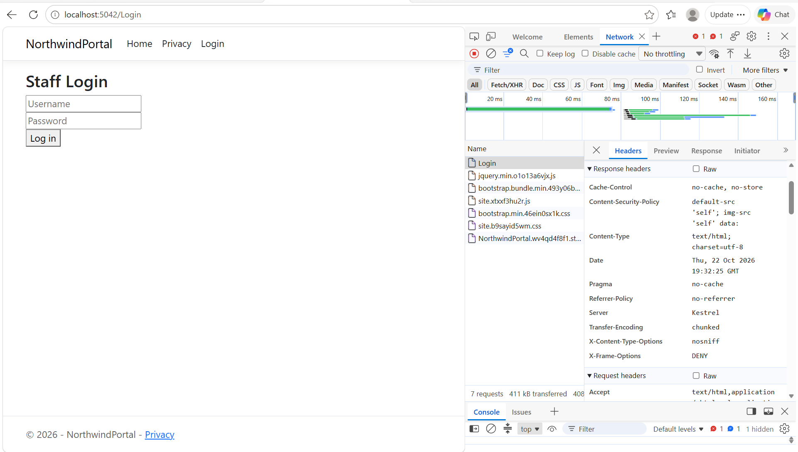

# SEC-102: Securing a .NET Web App (OWASP Top 10)

**Company (simulated):** Northwind Wellness  
**Ticket:** Harden the staff login portal before go-live  
**Stack:** ASP.NET Core 10 (Razor Pages), SQLite  
**Sec+ SY0-701 mapping:** Ch4 (password attacks), Ch6 (application security), Ch7 (cryptography), Ch8 (identity & access management)

## Summary
I built a staff login portal with deliberate flaws, exploited them, and fixed each one. The result is a before-and-after record of four common web vulnerabilities.

| # | Vulnerability | OWASP Top 10 | Fix |
|---|---------------|--------------|-----|
| 1 | SQL injection login bypass | A03 Injection | Parameterized queries |
| 2 | Plain-text passwords | A02 Cryptographic Failures | Salted hashing (ASP.NET `PasswordHasher`) |
| 3 | Unlimited login attempts | A07 Identification & Authentication Failures | Account lockout (3 tries / 5 min) |
| 4 | Missing security headers | A05 Security Misconfiguration | CSP, X-Frame-Options, nosniff, Referrer-Policy |

## Project structure
```
SEC-102-secure-dotnet-app/
├── README.md                  ← this report
├── .gitignore                 ← skips bin/, obj/, *.db
├── NorthwindPortal/           ← hardened ASP.NET Core 10 app (commented code)
│   ├── Program.cs             ← DB seeding (hashed passwords) + security headers
│   └── Pages/Login.cshtml(.cs)← parameterized query, hash check, lockout
├── vulnerable/                ← original insecure login, kept for comparison
└── screenshots/               ← evidence for each step
```

## How to run
```bash
cd NorthwindPortal
dotnet run
```
Open `http://localhost:5042/Login`. The demo accounts are `admin` / `Winter2026!` and `reception` / `password123`.

## 1. SQL injection
**Before:** User input was concatenated into the SQL string:
```csharp
var sql = $"SELECT Username FROM Users WHERE Username = '{Username}' AND Password = '{Password}'";
```
Entering `admin' --` as the username produced:
```sql
SELECT Username FROM Users WHERE Username = 'admin' --' AND Password = '...'
```
The `'` closes the string and `--` comments out the password check. **Result:** logged in as admin with no password.



**After:** Parameterized query:
```csharp
var sql = "SELECT PasswordHash FROM Users WHERE Username = @u";
cmd.Parameters.AddWithValue("@u", Username);
```
The database receives the SQL command and the user input separately, so input is always treated as data, never as code. `admin' --` now returns "Invalid login."



## 2. Password storage
**Before:** Passwords were stored in plain text. A stolen database would expose every password.

**After:** Passwords are hashed with ASP.NET Core's `PasswordHasher` (PBKDF2 with a random salt per user). A salt is a random value added to each password before hashing, so identical passwords produce different hashes and precomputed rainbow-table attacks don't work.



## 3. Brute-force protection
**Before:** Unlimited guesses, the same weakness exploited in [SEC-101](../SEC-101-ssh-bruteforce), where an attacker made 160 attempts before succeeding.

**After:** 3 failed attempts lock the account for 5 minutes. Even the correct password is refused while the account is locked.



**Known limitation:** Attempts are tracked in memory, so restarting the app resets them. Production should store attempts in the database (ASP.NET Identity's built-in lockout does this) and also rate-limit by IP.

## 4. Security headers
Added middleware that sets these headers on every response:

| Header | Value | Protects against |
|--------|-------|------------------|
| Content-Security-Policy | `default-src 'self'; img-src 'self' data:` | Cross-site scripting (XSS) |
| X-Frame-Options | `DENY` | Clickjacking |
| X-Content-Type-Options | `nosniff` | MIME-sniffing attacks |
| Referrer-Policy | `no-referrer` | URL leakage |



**Tuning the CSP:** After the CSP went live, it blocked two things:
1. Bootstrap's built-in `data:` SVG icon. Fixed by allowing `img-src 'self' data:`.
2. An inline `<script type="importmap">` in `_Layout.cshtml`. Fixed by removing the unused script.

**Security decision:** I chose not to add `'unsafe-inline'`, even though the browser suggested it, because that would disable the CSP's XSS protection.

## What I learned
- Never build SQL from strings. Always parameterize.
- Hash and salt passwords. Never store or log them in plain text.
- Lockout turns a brute-force attack into a dead end.
- A strict CSP can break your own site, so you have to fix the code instead of weakening the policy.

## Next steps (production)
- Move to ASP.NET Identity for persistent lockout, MFA, and password policies
- Enforce HTTPS with HSTS
- Add role-based access control (admin vs. reception)
- Log failed logins to a SIEM so they can be monitored
