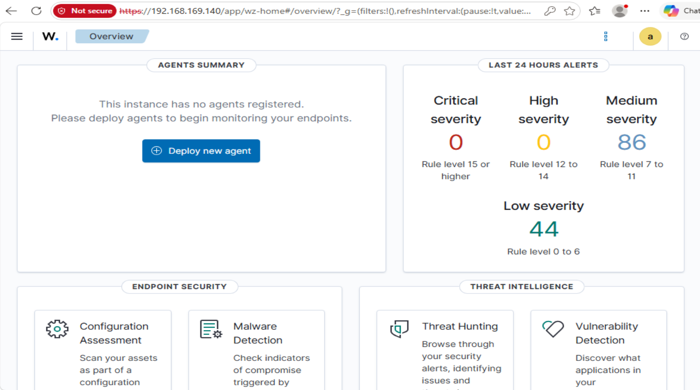
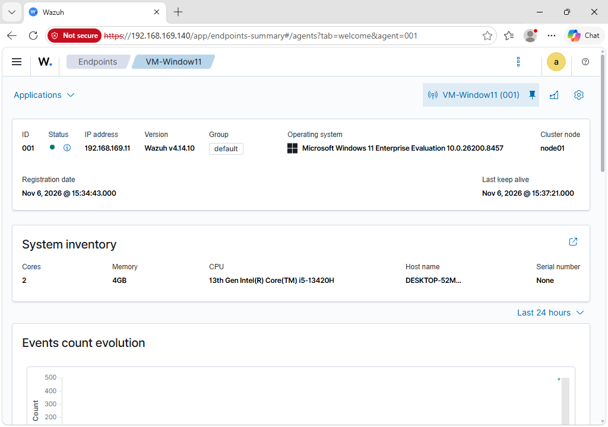
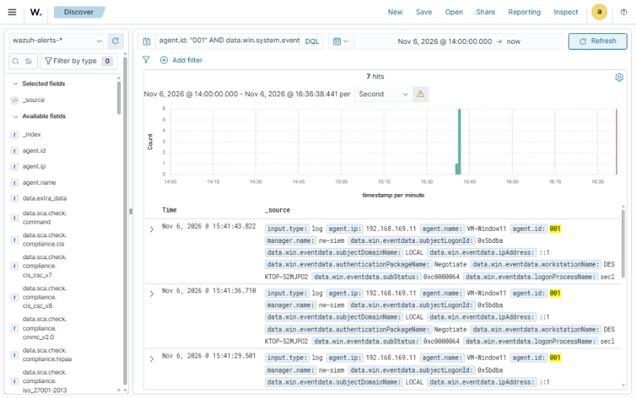
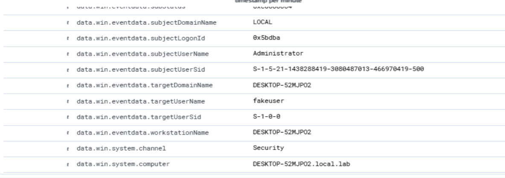
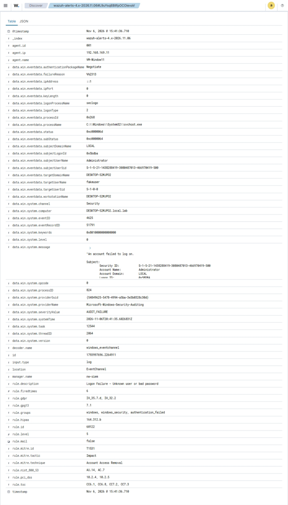

# SEC-103 — Northwind Wellness SIEM home lab (Wazuh)

**Status:** Sessions 1–3 complete (Nov 5–6, 2026)  
**Company context:** Northwind Wellness (simulated)  
**Maps to:** CompTIA Security+ SY0-701 (monitoring, detection, log analysis)  
**Stack:** Wazuh 4.14.10 all-in-one on an Ubuntu Server VM + Wazuh agent on a Windows 11 lab VM

## Ticket

> **NW-SEC-103** — Stand up a small SIEM so we can see auth and host alerts from lab endpoints.  
> Deliverable: working Wazuh dashboard, at least one Windows agent, screenshots + short write-up.

## Environment (as built)

| Role | Host / name | Notes |
|------|-------------|--------|
| Wazuh AIO (indexer + manager + dashboard) | Ubuntu Server **26.04.1** VM `nw-siem` | `192.168.169.140` |
| Windows agent | Windows 11 VM `VM-Window11` | Agent ID **001**, `192.168.169.11`, Wazuh **4.14.10**, status **Active** |

### Lab sizing (observed, not an official recommendation)

This lab used roughly **~6 GiB RAM / ~40 GB disk** for the Ubuntu SIEM VM. That is **below** common Wazuh quickstart guidance for small deployments (often cited around 4 vCPU / 8 GiB / 50 GB). The stack ran for this home-lab exercise; it is **not** claimed as officially supported sizing, and performance or stability may suffer under load.

Ubuntu version used here is **26.04.1** (what the lab VM was installed with). Do not treat older “24.04-only” notes in prior drafts as authoritative for this completed lab.

### Network / DNS notes

- Dashboard reached at `https://192.168.169.140` (browser showed the expected self-signed / untrusted TLS warning).
- Name resolution against lab DNS `192.168.169.10` **timed out** during agent/deploy troubleshooting.
- An explicit lookup using `8.8.8.8` **succeeded**.
- The Windows VM DNS was temporarily set to `8.8.8.8` / `1.1.1.1` so package and connectivity checks could proceed.

**Caveat:** This Windows VM is a **domain-member lab** host. Pointing it at public DNS may impair Active Directory name resolution and is **not** a production recommendation. Revert to appropriate lab/AD DNS when domain features are required.

## Sessions completed

| Session | Date (lab) | Goal | Outcome |
|---------|------------|------|---------|
| **1** | Nov 5, 2026 | Ubuntu SIEM VM + Wazuh AIO + first dashboard login | Dashboard Overview reachable; no agents yet ([01](screenshots/01-wazuh-dashboard-first-login.png)) |
| **2** | Nov 6, 2026 | Deploy Windows agent; confirm Active | `VM-Window11` (001) Active on `192.168.169.11` ([02](screenshots/02-agent-active-vm-window11.png)) |
| **3** | Nov 6, 2026 | Safe failed-logon test + triage in Discover | Filtered Event ID **4625** hits; inspected event matched intentional `fakeuser` test ([03](screenshots/03-discover-seven-4625-events.png), [04](screenshots/04-fakeuser-event-details.png), [05](screenshots/05-failed-logon-4625-full.png)) |

## Evidence findings (concise)

1. **SIEM up:** Wazuh dashboard served from `nw-siem` after AIO install; Overview showed medium/low self-generated alerts before any Windows agent.
2. **Agent path working:** Windows agent **001** registered, stayed **Active**, and forwarded Windows Security events into `wazuh-alerts-*`.
3. **Detection path verified:** Discover query `agent.id: "001" AND data.win.system.eventID: "4625"` returned **7** matching alerts in the triage window.
4. **One inspected event matched the intentional test:**  
   - Windows Event ID **4625**  
   - Target username: `fakeuser` (nonexistent local account)  
   - Initiating account: `Administrator`  
   - Logon type: **2** (interactive)  
   - Source address: `::1` (local loopback)  
   - Wazuh rule text: **Logon Failure - Unknown user or bad password**  
5. **Interpretation discipline:** Seven filtered matches are **not** asserted as seven confirmed separate test attempts, and they are **not** evidence of remote attack or compromise. The inspected event is **consistent with** the local intentional `runas` test against a nonexistent account.

Full triage write-up: [`triage-notes.md`](triage-notes.md). File list and hashes: [`evidence-index.md`](evidence-index.md).











## Skills demonstrated

- Standing up a Wazuh all-in-one SIEM VM and accessing the dashboard over HTTPS
- Deploying and validating a Windows Wazuh agent (Active status, inventory, keep-alive)
- Troubleshooting lab DNS reachability without treating public DNS as a production AD fix
- Querying Windows Security Event ID **4625** in Discover / DQL
- Expanding alert fields (`targetUserName`, `subjectUserName`, `logonType`, `ipAddress`) and writing a scoped triage conclusion
- Separating intentional lab tests from attack claims; documenting limitations honestly

## Limitations and honesty notes

- **Not production-hardened.** Default lab install; self-signed / untrusted TLS (“Not secure” in the browser).
- **Sizing below common quickstart guidance**; acceptable only as a constrained home lab.
- **Session 3 test was local only** (`::1`, interactive logon type 2). It does not demonstrate remote brute-force detection or incident response against a real adversary.
- **Domain DNS caveat** above applies if AD features are needed.
- An earlier lab credential was exposed during setup chatter. **Rotate that credential privately** in a password manager; **no passwords are stored in this package**.

## What this package contains

```text
SEC-103-wazuh-siem/
  README.md                 # this file
  triage-notes.md           # Session 3 triage
  evidence-index.md         # screenshot inventory + hashes
  screenshots/
    01-wazuh-dashboard-first-login.png
    02-agent-active-vm-window11.png
    03-discover-seven-4625-events.png
    04-fakeuser-event-details.png
    05-failed-logon-4625-full.png
```

**Excluded on purpose:** installer archives, password screenshots, login pages with credentials, plaintext secrets, and any git history or publish steps.

## References

- [Wazuh Quickstart](https://documentation.wazuh.com/current/quickstart.html)
- Windows Security Event ID 4625 — An account failed to log on
